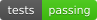

# Scraper de Domain.com.au

<!-- This README is generated by .github/scripts/docs.py from the scraper code, its results/ folder and .github/scrapers.json: change those and run the script instead of editing it. -->

[English](README.md) · [简体中文](README.zh-CN.md) · [日本語](README.ja.md) · **Español** · [Русский](README.ru.md) · [Deutsch](README.de.md) · [Français](README.fr.md) · [Português (Brasil)](README.pt-BR.md) · [한국어](README.ko.md)

[](https://github.com/scrapfly/scrapfly-scrapers/blob/ci-status/status/domaincom-scraper.md)

Scraper de ejemplo que recopila datos de anuncios de inmuebles de Domain.com.au, escrito en Python con la API de web scraping de [Scrapfly](https://scrapfly.io/). Forma parte de [scrapfly-scrapers](../docs/README.es.md).

- **Guía:** [How to Scrape Domain.com.au Real Estate Property Data](https://scrapfly.io/blog/posts/how-to-scrape-domain-com-au-real-estate-property-data)
- **Código:** [`domaincom.py`](domaincom.py) · **Ejecución de ejemplo:** [`run.py`](run.py) · **Tests:** [`test.py`](test.py)
- **Salida de ejemplo:** [Property pages](results/properties.json) · [Search pages](results/search.json)

## Qué extrae

- Búsqueda de inmuebles de Domain.com.au para encontrar anuncios
- Páginas de inmuebles de Domain.com.au para datos de anuncios de inmuebles

## Funciones

- `scrape_properties(urls)` → `List[Dict]`: scrape listing data from property pages
- `scrape_search(url, max_scrape_pages=None)`: scrape property listings from search pages

Las funciones son `async`: se ejecutan con `asyncio.run(...)` o con `await`.

### Ejemplo

Las entradas son los ejemplos de [`run.py`](run.py) (las listas largas aparecen recortadas):

```python
import asyncio
import domaincom


async def main():
    search = await domaincom.scrape_search(
        url="https://www.domain.com.au/sale/melbourne-vic-3000/",
        max_scrape_pages=1,
    )


asyncio.run(main())
```

## Salida

Las funciones devuelven diccionarios y listas simples. Campos de la salida de ejemplo (claves de primer nivel del primer elemento):

- [`results/properties.json`](results/properties.json): `listingId`, `listingUrl`, `unitNumber`, `streetNumber`, `street`, `suburb`, `postcode`, `createdOn`, `propertyType`, `beds`, `phone`, `agencyName`, `propertyDeveloperName`, `agencyProfileUrl`, `propertyDeveloperUrl`, `description`, `loanfinder`, `schools`, `suburbInsights`, `gallery`, `listingSummary`, `agents`, `features`, `structuredFeatures`, `faqs`, `url`
- [`results/search.json`](results/search.json): `id`, `listingType`, `listingModel`

## Configuración de Scrapfly

`BASE_CONFIG` en [`domaincom.py`](domaincom.py) contiene la configuración por defecto de las peticiones; consulta la [documentación de la Scrape API](https://scrapfly.io/docs/scrape-api/getting-started):

- `unblocker` = `True`: el [Unblocker](https://scrapfly.io/docs/scrape-api/unblocker) de Scrapfly, su sistema para evitar bloqueos anti-bot
- `country` = `"AU"`: país del proxy
- `proxy_pool` = `"public_residential_pool"`: pool de proxies (datacenter o residencial)

## Inicio rápido

Requiere Python 3.10+ y [Poetry](https://python-poetry.org/docs/#installation).

```shell
git clone https://github.com/scrapfly/scrapfly-scrapers.git
cd scrapfly-scrapers/domaincom-scraper
export SCRAPFLY_KEY="YOUR SCRAPFLY KEY"   # desde https://scrapfly.io/dashboard
poetry install --no-root
poetry run python run.py                  # scraping de ejemplo, guarda su salida en ./results
poetry run pytest test.py                 # los tests de este scraper
```

Tests: `test_properties_scraping`, `test_search_scraping`; para ejecutar uno: `poetry run pytest test.py -k <test>`. `run.py` y los tests hacen scraping del sitio web real, así que consumen créditos de Scrapfly.

Más: [todos los scrapers](../docs/README.es.md) · [llms.txt](../llms.txt) para agentes de IA
